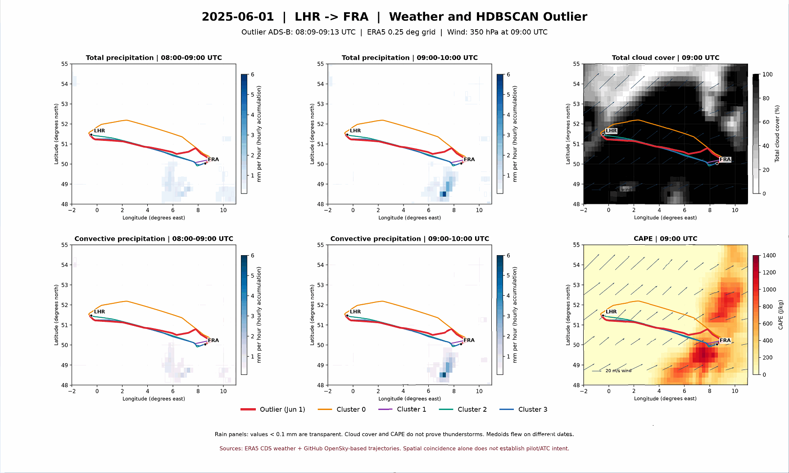
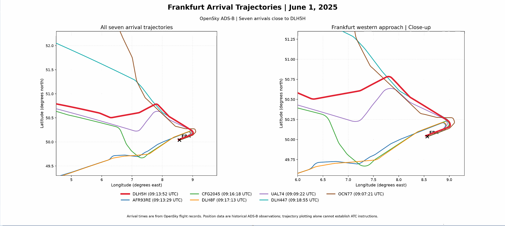

# Case study: DLH5H trajectory deviation on 1 June 2025

**Route:** London Heathrow (EGLL/LHR) to Frankfurt (EDDF/FRA)  
**Reference flight:** Lufthansa DLH5H, ICAO24 `3c65d8`, 08:09:37–09:13:52 UTC (OpenSky estimated observation interval)  
**Investigation:** Is the approach-path deviation better explained by weather avoidance, or by air traffic control (ATC) / arrival procedures?

> **Finding:** Weather avoidance was a plausible initial hypothesis. However, contemporaneous arrivals used both northern and southern approach paths, weakening any claim that the southern corridor was universally avoided. ATC vectoring and/or different arrival procedures remain plausible **but unconfirmed** alternatives. This is a geometric and contextual investigation, **not a determination of pilot or controller intent**.

## 1. Why was this flight investigated?

The parent project analyses 2025 DLH5H/A20N EGLL–EDDF flights with symmetric Hausdorff distance and HDBSCAN. From **309 quality-accepted flights**, the working HDBSCAN setting (`min_cluster_size=10`, `min_samples=5`) identifies **4 clusters (14, 180, 68, 33 flights)** and **14 noise-labelled flights (4.53%)**. Only **three flights** remain noise across all **15** tested settings: **1 June, 27 July, and 4 September 2025**.

The 1 June flight has the largest nearest-cluster-medoid symmetric Hausdorff distance of these three candidates, **73.80 km**. The flight largely follows the usual corridor before deviating **northward later in the route**, especially on approach to Frankfurt.

**Important:** 73.80 km is the maximum point-set separation from the nearest medoid, **not extra distance flown**. A noise label is a candidate for review, not a proven unsafe or operationally abnormal flight.

Parent-repository references: [Method](../../docs/METHOD.md), [Results](../../docs/RESULTS.md), [candidate table](../../data/lhr_fra_hdbscan_mcs10_ms5/noise_candidates.csv).

## Evidence sources and exact scripts

| Source / website | Dataset or variables | Study date and time (UTC) | Code in this folder | Output |
|---|---|---|---|---|
| [OpenSky Network historical data](https://openskynetwork.github.io/opensky-api/trino.html), accessed through the [2025 DLH5H parent-project dataset](../../data/README.md) | DLH5H flight metadata and cleaned observed latitude/longitude; HDBSCAN noise labels, cluster medoids, symmetric Hausdorff metric | DLH5H flight EGLL → EDDF, **2025-06-01 08:09:37–09:13:52**; clustering across the 2025 study set | Parent `run_pipeline.py`, `src/`; `scripts/plot_weather_case.py` reads their outputs | June 1 noise candidate, nearest-medoid Hausdorff **73.80 km** |
| [Copernicus Climate Data Store: ERA5 single levels](https://cds.climate.copernicus.eu/datasets/reanalysis-era5-single-levels?tab=overview) | `tp` total precipitation; `cp` convective precipitation; `tcc` total cloud cover; `cape` Convective Available Potential Energy | **2025-06-01**, hourly accumulated precipitation **08–09** and **09–10**, snapshots **09:00** | `scripts/plot_weather_case.py` | Six weather/track panels |
| [Copernicus Climate Data Store: ERA5 pressure levels](https://cds.climate.copernicus.eu/datasets/reanalysis-era5-pressure-levels?tab=overview) | `u`, `v` wind at **350 hPa** | **2025-06-01 09:00** | `scripts/plot_weather_case.py` | Wind vectors on CAPE and cloud maps |
| [OpenSky Trino / pyopensky](https://mode-s.org/pyopensky/trino.html) | `flightlist(arrival_airport="EDDF")`, followed by time-bounded `history(icao24=..., bounds=...)` and latitude/longitude/time | **2025-06-01**, **08:40–09:40** EDDF arrivals; position query **08:15–09:45** | `scripts/download_selected_arrivals.py` | User-reported **41** arrivals; seven selected trajectories and QA diagnostics |
| Local Windows flight CSV exports (not yet supplied as source files) | Position samples for OCN77, UAL74, AFR93RE, DLH5H, CFG2045, DLH8F, DLH447 | 2025-06-01; same arrival window | `scripts/import_local_exports.ps1`, `scripts/plot_seven_arrivals.py` | Seven-aircraft approach comparison preview |

**Visual evidence provenance:** the included weather and seven-arrival PNGs are crops of **screenshots supplied by the student**. They show the student's inspected figures and have not been substituted by synthetic test data. The original high-resolution PNGs and seven source CSVs should be imported from the student's Windows computer when available. See [data provenance](DATA_PROVENANCE.md) and [source/code matrix](SOURCE_CODE_MATRIX.md).

## 2. Investigation workflow

1. **Detect:** Rank persistent HDBSCAN noise candidates, then inspect 1 June (`DLH5H_3c65d8_1748765377_1748769232`).
2. **Localize:** Compare its horizontal track with the four HDBSCAN cluster medoids to identify the late-route northern deviation.
3. **Form weather hypothesis:** Inspect ERA5 total/convective precipitation, total cloud cover, CAPE and 350 hPa wind over the route on 1 June.
4. **Seek independent context:** Query OpenSky arrivals at EDDF between **08:40 and 09:40 UTC**, regardless of departure airport (**41 returned arrival records** in the user's local run).
5. **Compare:** Plot DLH5H with six arrivals close in arrival time (seven routes total). Identify different approach corridors and note aircraft coming from different directions.
6. **Reassess:** Weather alone does not account convincingly for every observed approach-path choice; consider ATC vectors, STAR/transitions, runway configuration, and changing local weather as unverified explanations.

## 3. ERA5 weather review



*Figure 1 (user-reviewed screenshot crop).* ERA5 total precipitation and convective precipitation accumulated during **08:00–09:00 and 09:00–10:00 UTC**; total cloud cover and convective available potential energy (CAPE) at **09:00 UTC**, with **350 hPa wind** overlaid on the last two panels. Routes show the June 1 DLH5H observation and four representative **medoid flights from other dates**; those medoids were **not** all flown on June 1.

### What can be said

- Some precipitation signal appears on the southern side of the mapped area; regions around/south-east of Frankfurt have relatively elevated 09:00 UTC CAPE in the displayed ERA5 grid.
- CAPE is the **potential energy available for buoyant ascent of an air parcel**, in J/kg. It is **not** directly observed updraft/downdraft speed, lightning, turbulence, or proof of an active thunderstorm.
- A representative cluster track crossing a colored weather pixel is **only a geometric overlay**: medoid flights operated on different dates.

### What cannot be concluded

- Neither elevated CAPE nor total cloud cover establishes hazardous convective weather at a particular aircraft's location and altitude.
- The precipitation panels are hourly accumulations; the other fields are 09:00 UTC snapshots. One 09:00 snapshot does not represent the whole 08:40–09:40 arrival window.
- ERA5's ~0.25° grid can miss localized aviation-relevant cells. Radar, satellite, lightning, METAR/TAF, SIGMET and contemporaneous operational data would add context.

## 4. Same-day arrival comparison

A local OpenSky Trino query returned **41 flights estimated to arrive at EDDF from 08:40 to 09:40 UTC on 1 June 2025**. Seven close-in-time arrivals were selected for visual comparison. These are **not** seven LHR-origin flights. Selection is purpose-driven, **not** a random or exhaustive study of westbound approaches.

| Callsign | Estimated arrival (UTC) | Relative to DLH5H | Initial visual category from shared plot |
|---|---:|---:|---|
| OCN77 | 09:07:21 | −6m31s | More northerly entry from a different direction |
| UAL74 | 09:09:22 | −4m30s | Intermediate/northern side |
| AFR93RE | 09:13:29 | −0m23s | Southern approach |
| **DLH5H** | **09:13:52** | **reference** | **Late northward deviation** |
| CFG2045 | 09:16:18 | +2m26s | Southern approach |
| DLH8F | 09:17:13 | +3m21s | Southern approach |
| DLH447 | 09:18:55 | +5m03s | More northerly entry from a different direction |



*Figure 2 (preview).* Seven OpenSky ADS-B observed trajectories, shown in the submitted Paint screenshot with the UI cropped away. The red DLH5H track deviates north; some other arrivals approach south, while UAL74 uses an intermediate route and OCN77/DLH447 enter from a different direction. **Replace the preview with the original high-resolution `7_flights_vs_DLH5H.png`**, if available locally; or use `scripts/plot_seven_arrivals.py` with the original CSV exports to regenerate it.

**Critical caveat:** Different arrival routes may reflect different origins/entry fixes, runway assignments, STARs, vectoring, altitude or local weather. Their presence does not establish which choice was available to DLH5H. The earlier diagnostic run labelled all seven position-age checks `DRAWN_AGE_UNVERIFIED`; see [data provenance](DATA_PROVENANCE.md).

## 5. Final working hypothesis (student interpretation)

**Initial hypothesis — convective-weather avoidance:** The June 1 DLH5H track followed the broad route corridor before deviating northward late in the flight. ERA5 showed some southern precipitation signal and elevated CAPE in/near the wider Frankfurt area, motivating an initial weather-avoidance hypothesis. CAPE measures available buoyant energy, not confirmed storms or turbulence.

**Test — same-day arrivals:** The student's OpenSky run returned 41 EDDF arrivals between 08:40 and 09:40 UTC. In a closer seven-flight comparison, **AFR93RE, CFG2045 and DLH8F used more southerly approach shapes**, while **UAL74 was more intermediate/northern** and **OCN77/DLH447 arrived from different directions**. This undermines the strong hypothesis that **all** aircraft avoided the southern region owing to a common severe-weather restriction.

**Revised/final working hypothesis — ATC or arrival procedure:** The student considers **ATC vectoring/arrival sequencing or differing STAR/transition/runway procedures** a more plausible explanation for the observed deviation than a uniform weather-avoidance mechanism. However, **the available ADS-B and ERA5 maps do not prove ATC instructions**, identify a controller clearance, or rule out aircraft-specific/localized weather avoidance. Distinct entry directions and 09:00 weather-snapshot timing prevent treating this as a controlled causal comparison.

**Suggested one-sentence conclusion:** *The contemporaneous mixed approach paths weaken a uniform convective-weather-avoidance explanation; ATC vectoring or differing arrival procedures are plausible explanations for DLH5H's northward deviation, but remain unverified without flight clearances and runway/procedure records.*

## 6. Evaluation of competing explanations

| Hypothesis | What supports it | What limits it | Current status |
|---|---|---|---|
| Weather avoidance | Some ERA5 precipitation signal and elevated regional CAPE | CAPE is potential, not observed storm activity; other nearby arrivals used southern paths; fields differ in time | **Possible, not confirmed** |
| ATC vectoring / sequencing | Arrival-path variation near the airport is compatible with ATC route assignment | No DLH5H ATC audio/clearance or controller data | **Plausible, not confirmed** |
| Different STAR / transition / runway | Different approach corridors, potentially different arrival directions | Actual procedures/runways on that day were not verified | **Plausible, not confirmed** |
| Other operational constraints | Airspace or traffic management can change routing | No verified NOTAM, restriction or flight-plan evidence presented | **Not established** |

**Provisional interpretation:** The observations weaken a strong, *uniform-weather-avoidance* explanation. They do **not** prove ATC causation or rule out local weather avoidance on an individual flight. The dataset supports a cautious **candidate mechanism**, not a causal finding.

## 7. Run or reproduce

### A. View the included results immediately

- `figures/weather_outlier_2025-06-01_6panels.png` — crop of the user-reviewed six-panel figure shown in the conversation (not the original high-resolution matplotlib export).
- `figures/7_flights_vs_DLH5H_preview_from_screenshot.png` — cropped screenshot preview of the seven-aircraft figure (not an original data export).
- `FIGURE_CAPTIONS.md` — reusable captions and attribution.
- `TEAM_SUMMARY_EN.md` — teammate briefing.

### B. Import existing Windows OpenSky exports (recommended)

The seven source-aircraft CSV files were produced on the user's Windows PC and were **not available as attachments** when this package was assembled. They are intentionally **not fabricated** or silently substituted.

In PowerShell, from this case-study directory:

```powershell
powershell -ExecutionPolicy Bypass -File .\scripts\import_local_exports.ps1
python -m pip install -r requirements.txt
python .\scripts\plot_seven_arrivals.py
```

The importer defaults to `$HOME\OpenSky_FRA_Approach_20250601` and copies `flight_*.csv`, the arrival manifest and QA diagnostic CSV (if present) into `data/opensky/`. It also copies the **original** seven-aircraft PNG when available. An alternate source can be supplied with `-SourcePath`.

### C. Optional fresh OpenSky download

When the local CSVs are unavailable, use your own authorized OpenSky Trino access (browser OAuth may be needed):

```powershell
python -m pip install -r requirements.txt
python .\scripts\download_selected_arrivals.py
python .\scripts\plot_seven_arrivals.py
```

This retrieves EDDF arrival metadata within **08:40–09:40 UTC** and attempts to download the seven named arrival trajectories in batches. Network permissions, history coverage and throttling can affect results. **Do not put login details, tokens or API secrets in this repository.**

### D. Regenerate the weather panels

Run from the parent repository root after cloning it, and with the included ERA5 NetCDF files present:

```powershell
python -m pip install -r case_studies\2025-06-01_DLH5H\requirements.txt
python case_studies\2025-06-01_DLH5H\scripts\plot_weather_case.py --repo-root .
```

The weather plot needs the parent's `data/lhr_fra_prepared/flight_points_clean.csv.gz`, cluster labels and medoid files; those belong to the established HDBSCAN pipeline. Regeneration saves to this case-study's `figures/`.

### E. Add this case study to the parent README

This case study is proposed on a dedicated GitHub review branch. The parent README will link to the case after merging.

## 8. Next verification steps

1. Check local flight CSVs, position-age units and track completeness; compare with the retained HDBSCAN DLH5H reference coordinates.
2. Identify runway configuration, STAR/transition and arrival direction for DLH5H and comparison flights.
3. Compare contemporaneous radar/lightning/satellite and relevant METAR/SIGMET data, matching each track's actual time and altitude.
4. If accessible and lawful, inspect contemporaneous ATC instructions; otherwise retain uncertainty.
5. Repeat the case-review method for the 27 July and 4 September persistent noise flights to assess repeatability.

## 9. Data credits and disclosure

- Flight observations: [OpenSky Network](https://opensky-network.org/); Trino historical data docs: <https://openskynetwork.github.io/opensky-api/trino.html>.
- Reanalysis weather: [Copernicus Climate Data Store, ERA5](https://cds.climate.copernicus.eu/datasets/reanalysis-era5-single-levels?tab=overview); also ERA5 pressure-level wind.
- Cluster method: [scikit-learn HDBSCAN](https://scikit-learn.org/stable/modules/generated/sklearn.cluster.HDBSCAN.html); parent [methodology](../../docs/METHOD.md).
- ChatGPT/Codex assisted with scripting, debugging, documentation, and packaging; see parent [`docs/AI_DISCLOSURE.md`](../../docs/AI_DISCLOSURE.md). Team members should verify analyses and document their own contributions.
